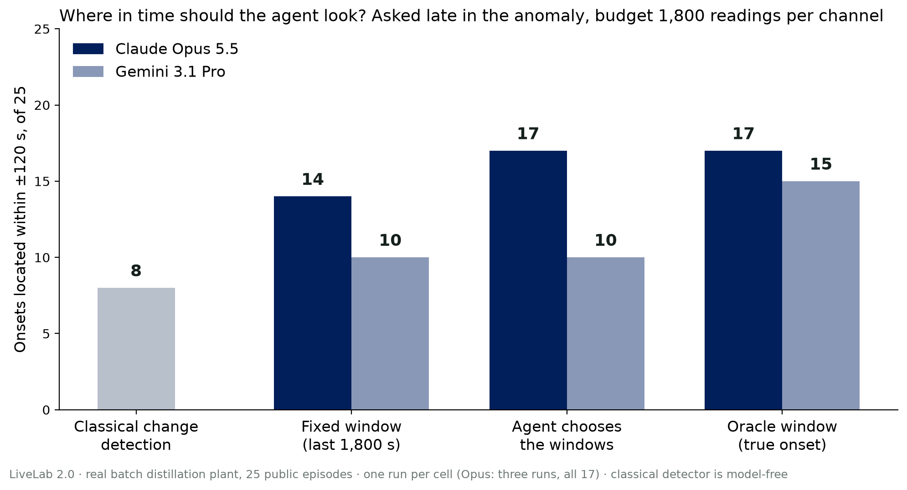

<div align="center">

# LiveLab 2.0

### Where in time should an agent look to find when an anomaly began?

Dekun Sun · University of Pennsylvania · [ai4s.fyi](https://ai4s.fyi)

Work in progress · 2026 · MIT

[**LiveLab 1.0**](https://github.com/dekunsun/livelab) · [**Preprint**](https://dekunsun.github.io/livelab/docs/preprint/preprint.html) · [Registration](docs/registration.md) · [Repeated runs](results/reps_summary.md) · [Second model](results/gemini_summary.md) · [中文](#中文版)



<sub>Onsets located within ±120 s of the expert annotation, 25 public anomaly episodes, asked late in the anomaly, budget 1,800 raw readings per channel. Dark: Claude Opus 5.5; light: Gemini 3.1 Pro. Counts read from the result records by <code>scripts/plot_arms_hits.py</code>.</sub>

</div>

---

An agent sees an anomaly now. Can it go back to the right stretch of history, find when the anomaly first became visible in the data, and fetch only as much raw data as the answer needs?

**Status.** Registered and run on 2026-10-14 (Claude Opus 5.5, one run per cell), then repeated twice and run on a second model. [LiveLab 1.0](https://github.com/dekunsun/livelab) stays frozen; nothing here changes its conclusions.

[中文版](#中文版)

## 1. Results

Onsets located within ±120 s, 25 public main-set episodes, evidence budget K = 1,800 raw readings per channel, Claude Opus 5.5:

| Arm | t₁ (just appeared) | t₂ (late in the anomaly) |
| --- | --- | --- |
| G always reports "now" (reference) | 5 | 0 |
| F2 classical detector (last sustained normal) | 8 | 8 |
| A current view and a 600 s coarse plot only | 19 | 11 |
| E fixed recent window | 20 | 14 |
| D active look-back (`get_window`, at most 4 calls) | 20 | 17 |
| B oracle window | 20 | 17 |

- **What holds.** Given a trend plot, the agent chose its own windows as well as an oracle, on about half the raw data, and beat the classical change detector (at t₂, D right and F2 wrong on 10 items, the reverse on 1).
- **Not shown.** That active look-back beats a fixed recent window (primary prediction P1). Over three runs D scored 17 at t₂ every time and E 14, 15 and 13: a stable gap of about 3 items, inside the registered no-interpretation band, and all of it from the 15 episodes LiveLab 1.0 had used; on the 10 unused public episodes it is 0 ([repeat registration](docs/registration_reps.md), [results](results/reps_summary.md)).
- **Consistent with 1.0.** When the raw data did not cover the onset, the model named an exact second rather than "before what I saw" (P5); on 37 injected false alerts it still reported an onset for 25 (P6).

## 2. A second model

Gemini 3.1 Pro, same items and prompts ([registration](docs/registration_gemini.md), [results](results/gemini_summary.md)): at t₂, E 10, D 10, B 15. Naming an exact second instead of "before what I saw" held in the same direction (10 to 1); it reported an onset for 19 of 37 injected false alerts, exactly half; but D fell 5 short of the oracle window, so "choosing as well as an oracle" is Opus's behaviour, not general. Across models only direction is read.

Item-level verdicts, problems with the scoring rule itself and limits: [registration](docs/registration.md) · [timeline](docs/timeline.md). Spend US$91.91 (Opus 57.20 including two repeats; Gemini 34.71).

## 3. Is there more data?

Not on this dataset: under the frozen item rules, every public episode that qualifies is already used, and the hold-out is reserved for qualification. The continuous mini-plant sets in NoBOOM were downloaded and profiled; their labels almost never mark when an anomaly became visible, so they cannot answer this question as posed ([feasibility check](docs/noboom_feasibility.md)). No new run is registered.

## 4. Repository

- [Item rules](docs/question_rules.md) (frozen) · [registration](docs/registration.md) (committed before any run, with a deviation log) · [one-shot steps](docs/one_shot_actions.md) · [timeline](docs/timeline.md) (append-only, UTC)
- `items/public.json`: public items; hold-out items stay on the author's machine, with only their sha256 in the repository
- `livelab2/`: archive and budget, prompts, scoring, model loop, mock agents; `scripts/`: item generation, runs, scoring, automatic checks, classical baselines, figures
- `results/`: every record keeps the full text sent to the model, every exchange, the audit of every window fetched, and the spend

## 5. Running it

```bash
python3 -m venv .venv && ./.venv/bin/pip install numpy pyyaml ruptures
# data: unzip the label and sensor archives of Zenodo 17395543 into data/raw/batch/ (see livelab2/data.py)
./.venv/bin/python scripts/run.py --agent mock-oracle --arm D --k 1800 --when t2   # no API key needed
./.venv/bin/python scripts/score.py results/mock-oracle/main_public
./.venv/bin/python scripts/checks.py results/mock-oracle/main_public
```

## 6. Data and licence

Data: Arweiler et al., *Batch Distillation Data for Developing Machine Learning Anomaly Detection Methods*, Scientific Data 2026; Zenodo [10.5281/zenodo.17395543](https://doi.org/10.5281/zenodo.17395543) (local copy version 1.1.3), CC BY 4.0. Raw data is not in this repository; records in `results/` contain excerpts of it, attributed under CC BY 4.0. The sensor legend `docs/data/tags.csv` comes from LiveLab 1.0. Code and documentation: MIT (`LICENSE`).

## 中文版

<details>
<summary>点开展开中文版</summary>

模型在当前时刻看到异常后，能否回到正确的历史时间窗口，找出异常从什么时候开始在数据里可见，并且只取足以回答的最少数据。

状态：**已登记并运行（2026-10-14，Claude Opus 5.5，每格一次）。** LiveLab 1.0（[github.com/dekunsun/livelab](https://github.com/dekunsun/livelab)）保持冻结，本仓库不改动它的任何结论。

## 结果

在 ±120 秒内定准起点的题数，公开主集 25 段，证据预算 K = 1,800 个原始读数 / 通道：

| 组 | t₁（刚出现） | t₂（异常后段） |
| --- | --- | --- |
| G 一律报“现在”（推算参照） | 5 | 0 |
| F2 经典算法（最后一次持续正常） | 8 | 8 |
| A 只看当前视图和 600 秒粗图 | 19 | 11 |
| E 固定的最近窗口 | 20 | 14 |
| D 主动回看（get_window，最多 4 次） | 20 | 17 |
| B 真值选窗 | 20 | 17 |

- **站得住的**：有趋势图时，模型自己选时间窗和完美检索一样准，用的原始数据约一半，并且明显好于经典变点算法（t₂ 上 D 对而 F2 错 10 题，反之 1 题）。
- **没证实的**：主动回看比固定的最近窗口更好（主预测 P1）。三次运行里 D 在 t₂ 都是 17 题，E 是 14 / 15 / 13，差距稳定但始终只有约 3 题，落在登记的“不解读”带内，而且全部来自 1.0 用过的 15 段，公开未用的 10 段上为 0（[重复运行登记](docs/registration_reps.md)、[结果](results/reps_summary.md)）。
- **和 1.0 一致的**：原始数据没覆盖起点时，模型多报一个精确秒数，而不说“在我看到的数据之前”（P5）；对人为注入的误报，37 题里 25 题照样报了起点（P6）。

- **第二个模型**（Gemini 3.1 Pro，同样的题和提示词，[登记](docs/registration_gemini.md)、[结果](results/gemini_summary.md)）：t₂ 上 E 10、D 10、B 15。“不说在此之前”同向成立（10 对 1）；注入误报题 19 / 37 报了起点，正好过半；但 D 比真值选窗少 5 题，“自选窗口和完美检索一样准”是 Opus 的表现，不普遍。跨模型只说方向。

逐条判定、计分规则自身的问题、局限：[登记](docs/registration.md) · [时间线](docs/timeline.md) · 设计文档（Claude Docs「LiveLab 2.0 · 设计」）。花费 US$91.91（Opus 57.20 含两次重复运行；Gemini 34.71）。

## 仓库

- [出题规则](docs/question_rules.md)（冻结）· [登记](docs/registration.md)（运行前提交，含偏差日志）· [不可重复的步骤](docs/one_shot_actions.md) · [时间线](docs/timeline.md)（只追加，UTC）
- `items/public.json`：公开题目；保留集题目只在作者本地，仓库里只有它的 sha256
- `livelab2/`：档案与预算、提示词、计分、模型循环、假智能体；`scripts/`：出题、运行、计分、自动检查、经典基线
- `results/`：每条记录保存发给模型的全文、每次交换、每次取数的审计和花费

```bash
python3 -m venv .venv && ./.venv/bin/pip install numpy pyyaml ruptures
# 数据：把 Zenodo 17395543 的标签包和传感器包解压到 data/raw/batch/（见 livelab2/data.py）
./.venv/bin/python scripts/run.py --agent mock-oracle --arm D --k 1800 --when t2   # 不需要 API key
./.venv/bin/python scripts/score.py results/mock-oracle/main_public
./.venv/bin/python scripts/checks.py results/mock-oracle/main_public
```

## 数据与许可

数据：Arweiler et al., *Batch Distillation Data for Developing Machine Learning Anomaly Detection Methods*, Scientific Data 2026；Zenodo [10.5281/zenodo.17395543](https://doi.org/10.5281/zenodo.17395543)（本地副本为 1.1.3 版），CC BY 4.0。原始数据不进本仓库；`results/` 里的记录包含该数据的片段，按 CC BY 4.0 注明来源。传感器图例 `docs/data/tags.csv` 来自 LiveLab 1.0。代码和文档：MIT（`LICENSE`）。

</details>
